 
 

<h2>About</h2>

I am a software engineer who enjoys the part of a product you never see: the APIs, data models, and services that decide whether it holds up under real use. I design backends in Python, and I build the web, desktop, and mobile clients that sit on top of them.

Most of my work revolves around ERP systems. I study how the leading products in the market are structured and what makes them work for real businesses, then apply those lessons to the systems I build.

I am also drawn to AI agents, and I prefer putting AI inside real workflows rather than around them, like reading medical documents or supporting decisions at the moment they are made.

<h2>Selected work</h2>

 

<h2>Tools I work with</h2>

  

